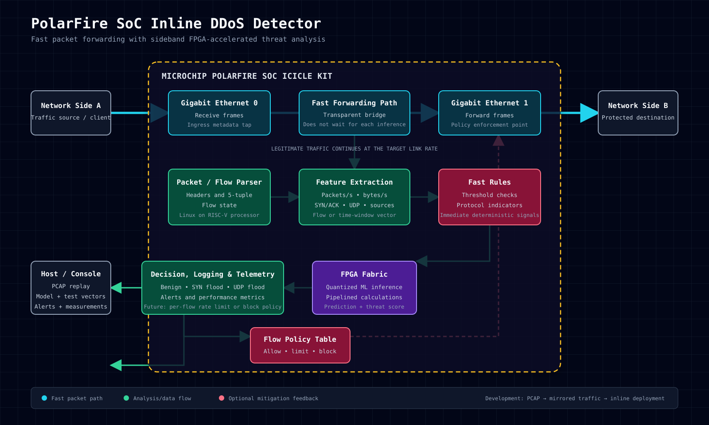

# Project Overview

## Problem Statement

Distributed denial-of-service (DDoS) attacks can overwhelm network bandwidth, packet-processing capacity, or connection-tracking resources before conventional software monitoring reacts. High-rate traffic analysis also competes with normal forwarding for CPU time, creating a difficult tradeoff between detection accuracy, response time, and network performance.

## Proposed Solution

We propose an inline, FPGA-accelerated network-threat detector built on the Microchip PolarFire SoC Icicle Kit. The system will forward traffic between two Gigabit Ethernet interfaces while a sideband analysis path extracts flow- and time-window-based features such as packet rate, byte rate, protocol counts, TCP flags, and source diversity. Fast deterministic rules will be combined with a trained, quantized machine-learning classifier implemented in the FPGA fabric. The processor will initially manage packet capture, flow tracking, configuration, and logging, while the FPGA accelerates suitable repeated calculations and inference. Development will progress from labeled PCAP data to mirrored live traffic and finally inline operation. Hardware predictions will be checked against a trusted software model using identical known-answer test vectors.

## Expected Outcome

The expected result is a reproducible prototype that distinguishes benign traffic, SYN floods, and UDP floods while forwarding legitimate traffic without materially bottlenecking the link. Success will be evaluated using classification accuracy, sustained throughput, packet loss, added latency, inference rate, CPU utilization, FPGA timing and resource usage, power consumption, and thermal behavior. The completed system should demonstrate whether FPGA acceleration provides a measurable performance or efficiency advantage and establish a foundation for later flow-based rate limiting or blocking.

# Novelty, Potential Impact, and Key Differentiators

## Novelty

The novelty lies in the system-level integration rather than claiming a new machine-learning algorithm. The design combines deterministic rules and quantized FPGA inference with an inline forwarding architecture whose analysis path does not stall every packet. It also treats software-to-hardware equivalence, throughput, latency, packet loss, power, and FPGA resource use as joint design requirements instead of evaluating classification accuracy alone.

## Potential Impact

A successful prototype could show how low-power, reconfigurable hardware can provide responsive network-threat detection near the traffic source without requiring a high-end server. The modular design can support later attack classes, alternative models, and flow-based mitigation policies.

## Key Differentiators

- Inline two-port deployment rather than detection from mirrored traffic alone
- Fast forwarding separated from slower flow/window classification
- Hybrid deterministic rules and quantized machine-learning inference
- Measured comparison against an equivalent CPU-only detector
- Reproducible verification across software, RTL simulation, and physical hardware
- Explicit evaluation of accuracy, throughput, latency, loss, power, and resource usage

## System Block Diagram

